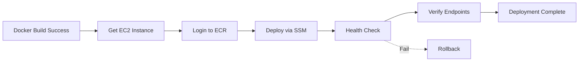

# Ron ZBD Challenge

[](https://github.com/YOUR_USERNAME/ron-zbd-challenge/actions)
[](https://github.com/YOUR_USERNAME/ron-zbd-challenge/actions)
[](https://github.com/YOUR_USERNAME/ron-zbd-challenge/actions)

This is a production-ready TypeScript application that exposes API endpoints using Express.js with Prometheus metrics, complete AWS infrastructure deployment using Terraform, and a fully automated CI/CD pipeline.

## 🚀 Features

- **Health Check Endpoint**: Simple endpoint to verify the service is running
- **Prometheus Metrics**: Exportable metrics for monitoring and observability
- **Request Counter**: Tracks total HTTP requests with labels for method, route, and status code
- **Configurable Port**: Port can be configured via environment variable
- **AWS Infrastructure**: Complete deployment to 2 EC2 instances with Docker containerization
- **Security Hardening**: Enhanced security configurations and monitoring
- **CI/CD Pipeline**: Automated Docker builds, security scanning, and deployments with GitHub Actions
- **Container Security**: Multi-layer vulnerability scanning with Trivy, Hadolint, and CodeQL
- **Dependency Management**: Automated dependency updates and security patches
- **Zero-Downtime Deployment**: Rolling deployments with health checks

## 📡 API Endpoints

### `/health`

A health check endpoint that returns a `200 OK` response with JSON containing status, message, and request metadata.

**Example:**
```bash
curl http://127.0.0.1:8080/health
```

**Response:**
```json
{
  "statusCode": 200,
  "message": "I'm healthy",
  "metadata": {
    "timestamp": "2025-10-09T01:23:45.678Z",
    "ip": "::1",
    "userAgent": "curl/7.68.0",
    "method": "GET",
    "path": "/health",
    "protocol": "http",
    "hostname": "127.0.0.1"
  }
}
```

### `/metrics`

Exports metrics in Prometheus format. This endpoint can be used to scrape stats from the application for monitoring purposes.

**Example:**
```bash
curl http://127.0.0.1:8080/metrics
```

**Response:**
```
# HELP http_requests_total Total number of HTTP requests
# TYPE http_requests_total counter
http_requests_total{method="GET",route="/health",status_code="200",app="ron-zbd-challenge"} 1
...
```

### `/hello`

An endpoint that returns a "Hello, world!" message with JSON containing status, message, and request metadata. This is useful for demonstrating the metrics functionality and generating traffic.

**Example:**
```bash
curl http://127.0.0.1:8080/hello
```

**Response:**
```json
{
  "statusCode": 200,
  "message": "Hello, world!",
  "metadata": {
    "timestamp": "2025-10-09T01:23:45.678Z",
    "ip": "::1",
    "userAgent": "curl/7.68.0",
    "method": "GET",
    "path": "/hello",
    "protocol": "http",
    "hostname": "127.0.0.1"
  }
}
```

## ⚙️ Configuration

### Environment Variables

- **`PORT`**: The port on which the server will listen (default: `8080`)

### Examples

Run on default port (8080):
```bash
cd app
npm start
```

Run on custom port (3000):
```bash
cd app
PORT=3000 npm start
```

Run on custom port (9090):
```bash
cd app
PORT=9090 npm start
```

## 🚀 Quick Start Guide

### Prerequisites

- **AWS Account** with appropriate permissions
- **Terraform** installed (v1.0+)
- **Node.js** (v18 or later recommended)
- **npm** (comes with Node.js)
- **Docker** (for containerization)

### Deployment Flow

Follow these steps in order:

1. **🚀 Bootstrap Infrastructure** (S3 bucket + DynamoDB table for Terraform state)
2. **🏗️ Deploy AWS Infrastructure** (Terraform)
3. **🔨 Build Application** (Docker)
4. **🚀 Deploy Application** to AWS instances
5. **📊 Monitor Application** (Prometheus + CloudWatch)

---

## 🚀 Step 0: Bootstrap Infrastructure

**First, create the foundational AWS resources** for Terraform state management.

### Deploy Bootstrap Resources

```bash
# Clone the repository
git clone https://github.com/your-username/ron-zbd-challenge.git
cd ron-zbd-challenge

# Bootstrap Terraform backend
cd terraform/bootstrap
./deploy.sh
```

This creates:
- **S3 Bucket**: `ron-zbd-challenge-terraform-state` (for storing Terraform state)
- **Security**: Encryption, versioning, and access controls
- **Note**: State locking disabled due to DynamoDB permission constraints

---

## 🏗️ Step 1: Deploy AWS Infrastructure

**Deploy the main infrastructure** after bootstrap is complete.

### Quick Deploy

```bash
# Clone the repository
git clone https://github.com/your-username/ron-zbd-challenge.git
cd ron-zbd-challenge

# Set your personal IP address
export PERSONAL_IP="YOUR_IP_ADDRESS"

# Create SSH key pair (optional - for SSH access)
cd terraform
./setup-ssh-key.sh

# Deploy infrastructure (select environment when prompted)
./deploy.sh
```

The script will prompt you to select either `dev` or `prod` environment.

**Important**: Set your personal IP address as an environment variable before deploying:
```bash
export PERSONAL_IP="203.0.113.1"  # /32 will be added automatically
```

You can get your IP address by visiting: https://whatismyipaddress.com/

This creates 2 EC2 instances ready for your application deployment.

### SSH Access

The infrastructure supports both SSH key access and AWS Systems Manager Session Manager:

#### Option 1: SSH Key Access (Recommended)

1. **Create SSH Key Pair**:
   ```bash
   cd terraform
   ./setup-ssh-key.sh
   ```

2. **Deploy with SSH Key**:
   ```bash
   export PERSONAL_IP="YOUR_IP_ADDRESS"
   export SSH_KEY_NAME="ron-zbd-challenge-key"  # Optional, uses default
   ./deploy.sh
   ```

3. **Connect via SSH**:
   ```bash
   chmod 400 ~/.ssh/ron-zbd-challenge-key.pem
   ssh -i ~/.ssh/ron-zbd-challenge-key.pem ec2-user@<instance-public-ip>
   ```

#### Option 2: AWS Session Manager

If you prefer not to use SSH keys, you can access instances via AWS Systems Manager:

```bash
# Install Session Manager plugin
curl "https://s3.amazonaws.com/session-manager-downloads/plugin/latest/ubuntu_64bit/session-manager-plugin.deb" -o "session-manager-plugin.deb"
sudo dpkg -i session-manager-plugin.deb

# Connect to instance
aws ssm start-session --target <instance-id>
```

---

## 🔨 Step 2: Build Application

After infrastructure is deployed, build your application.

### Local Development Setup

```bash
# Navigate to application directory
cd app

# Install dependencies
npm install

# Run locally for testing (optional)
npm start
```

The application will be running on `http://127.0.0.1:8080` by default.

---

## 🚀 Step 3: Deploy Application to AWS

After building your application, deploy it to the AWS infrastructure.

### Create Docker Image

```bash
# Create Dockerfile in app directory
cd app
cat > Dockerfile << EOF
FROM node:18-alpine
WORKDIR /app
COPY package*.json ./
RUN npm ci --only=production
COPY src/ ./src/
EXPOSE 8080
CMD ["npm", "start"]
EOF

# Build Docker image
docker build -t ron-zbd-challenge-api .
```

### Deploy to Instance A (API Server)

```bash
# SSH to your API instance
ssh -i your-key.pem ec2-user@<instance-a-ip>

# Navigate to app directory
cd /opt/app

# Create docker-compose.yml
cat > docker-compose.yml << EOF
version: '3.8'
services:
  api:
    image: ron-zbd-challenge-api:latest
    ports:
      - "8080:8080"
    restart: unless-stopped
EOF

# Deploy application
docker-compose up -d

# Verify deployment
docker ps
curl http://localhost:8080/health
```

### Deploy Prometheus to Instance B

```bash
# SSH to your Prometheus instance
ssh -i your-key.pem ec2-user@<instance-b-ip>

# Navigate to app directory
cd /opt/app

# Create Prometheus configuration
cat > prometheus.yml << EOF
global:
  scrape_interval: 15s

scrape_configs:
  - job_name: 'api-server'
    static_configs:
      - targets: ['<instance-a-ip>:8080']
    metrics_path: '/metrics'
EOF

# Create docker-compose.yml
cat > docker-compose.yml << EOF
version: '3.8'
services:
  prometheus:
    image: prom/prometheus:latest
    ports:
      - "9090:9090"
    volumes:
      - ./prometheus.yml:/etc/prometheus/prometheus.yml
    restart: unless-stopped
EOF

# Deploy Prometheus
docker-compose up -d

# Verify deployment
docker ps
curl http://localhost:9090
```

---

## 📊 Step 4: Monitor Application

Your application is now deployed and ready for monitoring.

### Access Monitoring Dashboards

- **API Health**: `http://<instance-a-ip>:8080/health`
- **API Metrics**: `http://<instance-a-ip>:8080/metrics`
- **Prometheus UI**: `http://<instance-b-ip>:9090`

### Test the Complete Setup

```bash
# Test API endpoints
curl http://<instance-a-ip>:8080/health
curl http://<instance-a-ip>:8080/hello
curl http://<instance-a-ip>:8080/metrics

# Check Prometheus targets
# Visit http://<instance-b-ip>:9090/targets
# Should show api-server target as UP
```

---

## 🏗️ Project Structure

```
ron-zbd-challenge/
├── app/                 # Application code
│   ├── src/
│   │   └── index.ts     # Main application file
│   ├── package.json     # Project dependencies and scripts
│   ├── package-lock.json # Lock file for dependencies
│   ├── tsconfig.json    # TypeScript configuration
│   └── node_modules/    # Node.js dependencies
├── terraform/           # Infrastructure as Code
│   ├── bootstrap/       # Bootstrap resources (S3 only)
│   │   ├── main.tf      # S3 bucket configuration
│   │   ├── deploy.sh    # Bootstrap deployment script
│   │   └── README.md    # Bootstrap documentation
│   ├── modules/         # Reusable Terraform modules
│   │   ├── vpc/         # VPC and networking
│   │   └── ec2/         # Single EC2 instance
│   ├── environments/    # Environment-specific configs
│   │   ├── dev/         # Development environment
│   │   └── prod/        # Production environment
│   ├── main.tf          # Root configuration
│   ├── backend.tf       # S3 backend configuration
│   └── test-security.sh # Security testing script
├── .github/workflows/   # CI/CD pipeline
└── README.md           # This file
```

## 📦 Dependencies

### Production Dependencies
- **express**: Fast, unopinionated web framework for Node.js
- **prom-client**: Prometheus client for Node.js

### Dev Dependencies
- **typescript**: TypeScript compiler
- **ts-node**: TypeScript execution environment for Node.js
- **@types/express**: TypeScript type definitions for Express
- **@types/node**: TypeScript type definitions for Node.js

## 📊 Metrics

The application exposes the following metrics:

- **`http_requests_total`**: Counter - Total number of HTTP requests
  - Labels:
    - `method`: HTTP method (e.g., GET, POST)
    - `route`: The endpoint path (e.g., /health, /metrics, /hello)
    - `status_code`: HTTP response status code (e.g., 200, 404)
    - `app`: Application name (ron-zbd-challenge)

### Using with Prometheus

To scrape metrics from this application with Prometheus, add the following to your `prometheus.yml` configuration:

```yaml
scrape_configs:
  - job_name: 'ron-zbd-challenge'
    static_configs:
      - targets: ['localhost:8080']
    metrics_path: '/metrics'
    scrape_interval: 15s
```

## 🧪 Testing

First, make sure the application is running:
```bash
cd app
npm start
```

Then test all endpoints:
```bash
# Health check
curl http://127.0.0.1:8080/health

# Generate some traffic
curl http://127.0.0.1:8080/hello
curl http://127.0.0.1:8080/hello
curl http://127.0.0.1:8080/hello

# Check metrics
curl http://127.0.0.1:8080/metrics
```

---

## ☁️ Detailed AWS Infrastructure Guide

This section provides detailed information about the AWS infrastructure deployment.

### 🏗️ Architecture Overview

```
┌─────────────────────────────────────────────────────────────┐
│                    AWS Infrastructure                       │
├─────────────────────────────────────────────────────────────┤
│  VPC (10.0.0.0/16)                                         │
│  ┌─────────────────┐    ┌─────────────────┐                │
│  │   Instance A    │    │   Instance B    │                │
│  │  (API Server)   │    │  (Prometheus)   │                │
│  │                 │    │                 │                │
│  │ • Docker API    │    │ • Prometheus    │                │
│  │ • Port 8080     │    │ • Port 9090     │                │
│  │ • /metrics      │◄──►│ • Scraping      │                │
│  └─────────────────┘    └─────────────────┘                │
│                                                             │
│  Security Groups:                                           │
│  • SSH: Personal IP only                                   │
│  • API: Source security group for /metrics                 │
│  • Prometheus: Public access                               │
└─────────────────────────────────────────────────────────────┘
```

### 🔧 Deployment Options

#### Option 1: Manual Deployment (Root Directory)
```bash
cd terraform
export PERSONAL_IP="YOUR_IP_ADDRESS/32"
terraform init
terraform plan -var="personal_ip=$PERSONAL_IP"
terraform apply -var="personal_ip=$PERSONAL_IP"
```

#### Option 2: Environment-Specific Deployment
```bash
# Development Environment
cd terraform/environments/dev
export PERSONAL_IP="YOUR_IP_ADDRESS/32"
terraform init
terraform plan -var="personal_ip=$PERSONAL_IP"
terraform apply -var="personal_ip=$PERSONAL_IP"

# Production Environment
cd terraform/environments/prod
export PERSONAL_IP="YOUR_IP_ADDRESS/32"
terraform init
terraform plan -var="personal_ip=$PERSONAL_IP"
terraform apply -var="personal_ip=$PERSONAL_IP"
```

### 🏢 Environment-Specific Configuration

#### Development Environment
- **Instance Type**: t3.micro
- **Volume Size**: 20GB
- **VPC CIDR**: 10.0.0.0/16
- **Log Retention**: 14 days

#### Production Environment
- **Instance Type**: t3.small
- **Volume Size**: 50GB
- **VPC CIDR**: 10.1.0.0/16
- **Log Retention**: 30 days

### 🔒 Security Configuration

#### SSH Access
- **Restricted to personal IP only** (`${var.personal_ip}/32`)
- **No password authentication** - Key-based only
- **Connection limits** and timeout configured

#### Security Group Rules
- **Instance A (API Server)**:
  - SSH: Personal IP only
  - HTTP/HTTPS: Public access
  - Port 8080: Public access + Prometheus security group
  - **Metrics endpoint**: Only accessible from Prometheus instance

- **Instance B (Prometheus)**:
  - SSH: Personal IP only
  - HTTP/HTTPS: Public access
  - Port 9090: Public access (Prometheus UI)

#### Security Verification
Run the security test script:
```bash
cd terraform
./test-security.sh
```

### 🏗️ Modular Architecture

The infrastructure is organized into reusable modules:

```
terraform/
├── modules/
│   ├── vpc/                    # VPC and networking
│   │   ├── main.tf
│   │   ├── variables.tf
│   │   └── outputs.tf
│   └── ec2/                    # Single EC2 instance (reusable)
│       ├── main.tf
│       ├── variables.tf
│       ├── outputs.tf
│       └── user_data.sh
├── main.tf                     # Module instantiation with literal values
├── outputs.tf                  # Root outputs
└── deploy.sh                   # Deployment script
```

#### Module Benefits
- **🔧 Reusability**: Modules can be used across different environments
- **📦 Separation of Concerns**: VPC and EC2 logic separated
- **🔄 Maintainability**: Easier to update and modify individual components
- **🧪 Testability**: Each module can be tested independently
- **📚 Documentation**: Clear structure with focused responsibilities

### 📋 What Gets Created

- **2 EC2 t3.micro instances** (`instance-a` and `instance-b`) running **Amazon Linux 2023** (security-hardened)
- **VPC with public subnet** and security groups
- **CloudWatch logging** for centralized logs
- **Docker-ready infrastructure** for running any containerized application
- **Enhanced security hardening** including:
  - Firewall (firewalld) configuration
  - SSH hardening with key-only auth
  - Automatic security updates
  - Kernel security parameters
  - File system security
  - Docker and Docker Compose installed

### 🚪 Access Your Infrastructure

After deployment, SSH to your instances:

```bash
# SSH to instance (Amazon Linux 2023)
ssh -i your-key.pem ec2-user@<instance-ip>

# Check system status
/opt/app/monitor.sh

# Check Docker status
docker --version
docker-compose --version
systemctl status docker
```

---

## 🔄 CI/CD Pipeline

The project includes a comprehensive CI/CD pipeline with automated builds, security scanning, and deployments.

### 🚀 Quick Start

For detailed setup instructions, see **[CI/CD Setup Guide](.github/SETUP.md)**.

#### Required GitHub Secrets

Add these secrets to your repository (Settings → Secrets and variables → Actions):

```bash
AWS_ACCESS_KEY_ID=your_access_key          # Required
AWS_SECRET_ACCESS_KEY=your_secret_key      # Required
SNYK_TOKEN=your_snyk_token                 # Optional
SONAR_TOKEN=your_sonar_token               # Optional
```

### 📦 Workflows

#### 1. Docker Build, Security Scan & Push to ECR

**File:** `.github/workflows/docker-build-push.yml`

**Triggers:**
- Push to `main` or `develop` branches
- Pull requests
- Manual dispatch

**Features:**
- ✅ Multi-stage Docker builds with BuildKit caching
- ✅ Trivy vulnerability scanning (container images)
- ✅ Hadolint Dockerfile linting
- ✅ Secret scanning in source code
- ✅ Automated push to Amazon ECR
- ✅ ECR lifecycle policy management
- ✅ SARIF upload to GitHub Security tab

**Security Checks:**
```yaml
- Container OS vulnerabilities (CRITICAL, HIGH)
- Library/dependency vulnerabilities
- Dockerfile best practices
- Hardcoded secrets detection
- Image size optimization
```

#### 2. Dependency Security & Updates

**File:** `.github/workflows/dependency-security.yml`

**Triggers:**
- Weekly schedule (Monday 9 AM UTC)
- Changes to package files
- Manual dispatch

**Features:**
- ✅ npm audit for vulnerability detection
- ✅ Snyk security scanning
- ✅ Automated dependency update PRs
- ✅ License compliance checking (blocks GPL)
- ✅ Outdated package detection
- ✅ Dependency review on PRs

**Automated Updates:**
The workflow creates pull requests weekly with:
- Updated dependencies
- Security patches via `npm audit fix`
- Detailed changelog

#### 3. Code Quality & Security Analysis

**File:** `.github/workflows/code-quality.yml`

**Triggers:**
- Push to `main` or `develop`
- Pull requests
- Manual dispatch

**Features:**
- ✅ TypeScript compilation checks
- ✅ ESLint static analysis
- ✅ CodeQL security analysis
- ✅ GitLeaks secret detection
- ✅ Semgrep pattern analysis
- ✅ OWASP dependency check
- ✅ Unused dependency detection
- ✅ Package size analysis

**Security Coverage:**
```yaml
Languages: JavaScript, TypeScript
Scanners: CodeQL, Semgrep, GitLeaks, OWASP
Patterns: Security, Secrets, Node.js best practices
```

#### 4. Deploy to AWS EC2

**File:** `.github/workflows/deploy.yml`

**Triggers:**
- Successful Docker build workflow completion
- Manual dispatch with environment selection

**Features:**
- ✅ Zero-downtime deployments via AWS SSM
- ✅ Automated health checks
- ✅ Rollback on failure
- ✅ Multiple environment support (dev/prod)
- ✅ Deployment verification
- ✅ CloudWatch logging integration

**Deployment Flow:**


### 🐳 Local Development

#### Build and Run with Docker Compose

```bash
# Build and start all services
docker-compose up -d

# View logs
docker-compose logs -f

# Stop services
docker-compose down
```

**Services:**
- **API**: http://localhost:8080
- **Prometheus**: http://localhost:9090
- **Grafana**: http://localhost:3000 (admin/admin)

#### Build Docker Image Locally

```bash
cd app
docker build -t ron-zbd-challenge-api .
docker run -p 8080:8080 ron-zbd-challenge-api
```

### 🔒 Security Features

The CI/CD pipeline includes multiple security layers:

| Layer | Tools | Frequency |
|-------|-------|-----------|
| **Container Security** | Trivy, Hadolint | Every build |
| **Dependency Security** | npm audit, Snyk, OWASP | Weekly + PRs |
| **Code Security** | CodeQL, Semgrep, GitLeaks | Every commit |
| **Secret Detection** | Trivy, GitLeaks | Every commit |
| **License Compliance** | license-checker | Every commit |

**Vulnerability Thresholds:**
- Container: CRITICAL and HIGH must be addressed
- Dependencies: MODERATE and above require review
- Secrets: Any detection blocks deployment

### 📊 Monitoring & Observability

#### GitHub Security Tab

View all security findings in one place:
- Navigate to **Security** → **Code scanning**
- Review alerts from Trivy, CodeQL, Semgrep
- Check **Dependabot** for dependency alerts

#### Build Metrics

Each workflow run provides:
- Build time and status
- Security scan results
- Deployment verification
- Resource usage
- Endpoint health checks

#### Deployment Tracking

After deployment, the workflow provides:
```
✅ Deployment Summary
- Environment: dev
- Image: ron-zbd-challenge-api:abc123
- Instance ID: i-1234567890
- Endpoints:
  * Health: http://x.x.x.x:8080/health
  * Metrics: http://x.x.x.x:8080/metrics
```

### 🔧 Advanced Configuration

#### Customize Security Thresholds

Edit workflow files to adjust sensitivity:

```yaml
# .github/workflows/docker-build-push.yml
- name: Run Trivy vulnerability scanner
  with:
    severity: 'CRITICAL,HIGH,MEDIUM'  # Add MEDIUM
    exit-code: '1'  # Fail build on findings
```

#### Add New Environments

1. Create Terraform environment: `terraform/environments/staging/`
2. Update deploy workflow with new environment option
3. Configure environment-specific secrets in GitHub

#### Enable Advanced Features

**SonarCloud Integration:**
1. Sign up at sonarcloud.io
2. Add `SONAR_TOKEN` to GitHub secrets
3. Update organization/project in workflow

**Snyk Integration:**
1. Sign up at snyk.io
2. Add `SNYK_TOKEN` to GitHub secrets
3. Workflow will automatically use it

### 📈 Pipeline Performance

**Target Metrics:**
- Build time: < 5 minutes
- Security scan: < 2 minutes
- Deployment: < 3 minutes
- Success rate: > 95%

**Optimization Features:**
- Docker layer caching with GitHub Actions cache
- Parallel job execution
- Incremental builds
- Artifact caching

### 🐛 Troubleshooting

Common issues and solutions:

**ECR Push Failed:**
```bash
# Verify AWS credentials
aws ecr describe-repositories --region us-east-1

# Manually create repository if needed
aws ecr create-repository --repository-name ron-zbd-challenge-api
```

**Deployment Failed:**
```bash
# Check EC2 instance status
aws ec2 describe-instances --filters "Name=tag:Name,Values=*instance-a"

# Verify SSM agent
aws ssm describe-instance-information
```

**Security Scan Failures:**
- Review findings in GitHub Security tab
- Update vulnerable dependencies
- Check for false positives

For detailed troubleshooting, see **[CI/CD Setup Guide](.github/SETUP.md)**.

### 📚 Additional Resources

- **[CI/CD Setup Guide](.github/SETUP.md)** - Detailed setup instructions
- **[GitHub Actions Docs](https://docs.github.com/actions)** - Official documentation
- **[Trivy Documentation](https://aquasecurity.github.io/trivy/)** - Container scanning
- **[AWS ECR Guide](https://docs.aws.amazon.com/ecr/)** - Container registry

## 📊 Monitoring Setup

### Prometheus Configuration
Instance B runs Prometheus to scrape metrics from Instance A:

```yaml
# Prometheus configuration (deployed via Docker)
scrape_configs:
  - job_name: 'api-server'
    static_configs:
      - targets: ['instance-a-ip:8080']
    metrics_path: '/metrics'
    scrape_interval: 15s
```

### CloudWatch Integration
- **Log Groups**: `/aws/ec2/ron-zbd-challenge-{env}`
- **Log Streams**: Separate streams for each instance
- **Retention**: 14 days (dev), 30 days (prod)

### Testing Security Groups

#### Verify Prometheus Can Access API Metrics
```bash
# SSH to Prometheus instance
ssh -i your-key.pem ec2-user@<instance-b-ip>

# Test metrics access
curl -f http://<instance-a-ip>:8080/metrics
```

#### Test Security Group Misconfiguration
1. **Remove security group rule**:
   ```hcl
   # Comment out in terraform/environments/dev/main.tf
   # prometheus_security_group_id = module.instance_b.security_group_id
   ```

2. **Apply changes**:
   ```bash
   terraform apply
   ```

3. **Verify Prometheus cannot access metrics**:
   ```bash
   curl -f http://<instance-a-ip>:8080/metrics
   # Should fail with connection refused/timeout
   ```

---

## 🏗️ Terraform Modules

### VPC Module (`terraform/modules/vpc/`)

Creates the networking foundation:
- VPC with DNS support
- Internet Gateway
- Public subnet
- Route table and associations

**Usage:**
```hcl
module "vpc" {
  source = "./modules/vpc"
  
  project_name         = "my-project"
  environment          = "prod"
  vpc_cidr            = "10.0.0.0/16"
  public_subnet_cidr  = "10.0.1.0/24"
  availability_zone   = "us-east-1a"
}
```

### EC2 Module (`terraform/modules/ec2/`)

Creates a single secure EC2 instance with:
- 1 EC2 instance (configurable name)
- Security groups with appropriate rules
- IAM roles and policies for CloudWatch
- CloudWatch log group
- Generic infrastructure setup (Docker, security hardening)

**Usage:**
```hcl
module "instance_a" {
  source = "./modules/ec2"
  
  project_name               = "my-project"
  environment                = "prod"
  vpc_id                    = module.vpc.vpc_id
  subnet_id                 = module.vpc.public_subnet_id
  ami_id                    = "ami-12345678"
  instance_name             = "instance-a"
  instance_type             = "t3.micro"
  allowed_ssh_cidrs         = ["10.0.0.0/8"]
  cloudwatch_log_group_name = "/aws/ec2/my-project"
}

# Create multiple instances by instantiating multiple times
module "instance_b" {
  source = "./modules/ec2"
  
  project_name               = "my-project"
  environment                = "prod"
  vpc_id                    = module.vpc.vpc_id
  subnet_id                 = module.vpc.public_subnet_id
  ami_id                    = "ami-12345678"
  instance_name             = "instance-b"
  instance_type             = "t3.micro"
  allowed_ssh_cidrs         = ["10.0.0.0/8"]
  cloudwatch_log_group_name = "/aws/ec2/my-project"
}
```

#### Module Structure
Each module follows the standard Terraform module structure:

```
module-name/
├── main.tf      # Main resource definitions
├── variables.tf # Input variables
├── outputs.tf   # Output values
└── README.md    # Module documentation (optional)
```

#### Module Benefits
- **Reusability**: Use modules across different environments
- **Maintainability**: Update modules independently
- **Testing**: Test modules in isolation
- **Documentation**: Clear interfaces with variables and outputs

## 🚨 Troubleshooting

### Common Issues

1. **SSH Access Denied**:
   - Verify your IP address in terraform.tfvars
   - Check security group rules
   - Ensure SSH key is correct

2. **Prometheus Cannot Scrape Metrics**:
   - Verify security group rules allow Prometheus to access API
   - Check if API is running on Instance A
   - Verify network connectivity between instances

3. **CI/CD Pipeline Fails**:
   - Check GitHub secrets are configured
   - Verify AWS credentials have sufficient permissions
   - Check ECR repository exists

### Useful Commands

```bash
# Check security group rules
aws ec2 describe-security-groups --group-ids <security-group-id>

# View CloudWatch logs
aws logs describe-log-groups --log-group-name-prefix "/aws/ec2/ron-zbd-challenge"

# Check instance status
aws ec2 describe-instances --instance-ids <instance-id>
```

## 🧹 Cleanup

```bash
terraform destroy
```

## 📋 Security Checklist

- ✅ SSH access restricted to personal IP
- ✅ Security groups use source security group rules for metrics access
- ✅ Automatic security updates enabled
- ✅ Firewall configured with minimal required ports
- ✅ CloudWatch logging enabled
- ✅ Container vulnerability scanning in CI/CD
- ✅ Terraform state encrypted in S3
- ✅ Environment separation (dev/prod)

## 🎯 Next Steps

1. **Set your personal IP** as an environment variable: `export PERSONAL_IP="YOUR_IP/32"`
2. **Set up GitHub secrets** for CI/CD
3. **Deploy development environment** using `./deploy.sh`
4. **Test security group configuration**
5. **Deploy API and Prometheus applications**
6. **Verify monitoring is working**
7. **Deploy to production when ready**

## 📄 License

ISC